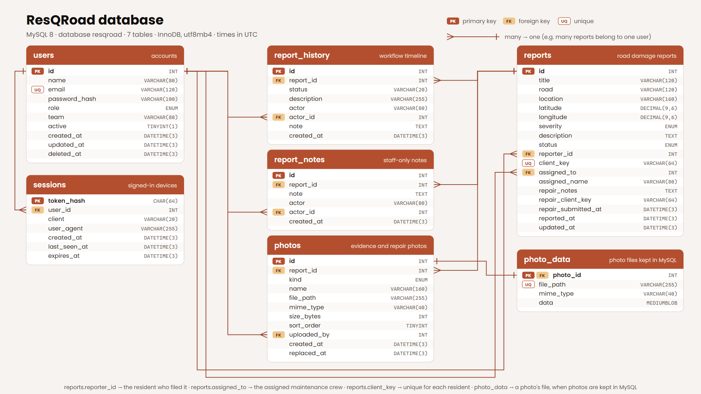

# ResQRoad

ResQRoad is a road damage reporting and maintenance management system for local
government. Residents report road problems, and the LGU's Road Maintenance
Office verifies, assigns, tracks, and resolves them from a central workspace.

The website is plain HTML, CSS, and JavaScript (no build step), served by a
small **Node.js** server backed by a **MySQL** database. The same server is the
API for the ResQRoad mobile app, so the website and the app share one database,
one set of accounts, and the same live updates.

- **Real accounts**: passwords are stored as bcrypt hashes in MySQL, and the
  server checks every request against the account's role.
- **Photos on the server**: evidence and repair photos are uploaded to
  `storage/photos/`, not kept in the browser.
- **Live on every device**: when anyone changes something, every open page and
  app on any phone or computer updates within a moment (over a WebSocket).

## Run locally

You need [Node.js](https://nodejs.org/) 20.12 or newer and MySQL 8.0 or newer
(MariaDB 10.4+ from XAMPP also works).

1. **Start MySQL.** For the MySQL 8.0 service: open **Services**
   (`services.msc`), find **MySQL80**, and click **Start** (set its startup type
   to *Automatic* so it starts with Windows). If XAMPP's MySQL is running, stop
   it first: both use port 3306.
2. **Configure the connection.** Copy `.env.example` to `.env` and set
   `DB_PASSWORD` to your MySQL `root` password (the one chosen when MySQL was
   installed). `.env` is never committed.
3. **Install and set up** (from this folder):

   ```powershell
   npm install
   npm run db:setup       # creates the `resqroad` database and tables
   npm run create-admin   # creates your administrator account
   npm run seed           # optional: sample accounts and 21 sample reports
   ```

4. **Start the server:**

   ```powershell
   npm start
   ```

   Then open <http://localhost:8000/>. The server also prints addresses such as
   `http://192.168.1.13:8000/` that phones and other computers **on the same
   Wi-Fi** can open (allow Node.js through Windows Firewall when asked). Note:
   phones only allow "Use my location" on `localhost` or HTTPS, so on a LAN
   address residents drop a pin on the map instead.

`npm run dev` restarts the server automatically when server files change.

## Pages

| Page | Who | What it does |
| --- | --- | --- |
| `index.html` | Everyone | Public landing page: live numbers, how it works, a live map of verified reports, recently fixed roads, and the report tracker at the bottom (`index.html?track=RPT-1048#track` opens a report there). |
| `login.html` | Everyone | One sign-in for residents, administrators, and maintenance crews. The account decides which workspace opens. |
| `register.html` | Residents | Create a free resident account (signs you in right away). |
| `citizen.html` | Residents | Report a road problem in four steps (the problem, the location by map pin or GPS, photos, and a review before sending), follow every report you've filed, open its full details, rate a finished repair, and — without leaving the portal — track a report by ID, browse the live map, and see the public site. |
| `admin.html` | Administrator | Dashboard, Insights & Statistics (with a printable report), Review Reports, Task Dispatch, Live Map, User management, and the public site. |
| `maintenance.html` | Maintenance crews | Overview, assigned jobs (start repairs, submit notes with after-repair photos), repair sites, and the public site. |
| `admin-login.html`, `maintenance-login.html` | — | Old sign-in addresses; they redirect to `login.html`. |
| `track.html` | — | Old tracker address; `track.html?id=RPT-1048` redirects to the tracker on the home page. |

The three workspaces (`admin.html`, `maintenance.html`, `citizen.html`) are
only served to someone signed in with that role; anyone else is sent to the
sign-in page. They are never cached, so after logging out the browser's Back
button can't show them again.

## Accounts

Everyone signs in on `login.html`; there is no role picker. The server checks
the email and password, and the account's role decides which workspace opens.
Sign-ins last 30 days (renewed while in use) or until you log out.

- **Administrators** are created with `npm run create-admin` (it can also
  reset an administrator's password). They can't be created from the website.
- **Maintenance crews**: the administrator adds them in **User management**
  with a temporary password (8+ characters with a letter and a number) and
  shares it with that person privately. A crew account with open jobs can't be
  deleted until its work is reassigned or finished. A deleted crew account can
  no longer sign in; its name stays on past reports, and its email can't be
  reused.
- **Residents** create their own accounts on `register.html` (8+ characters
  with a letter and a number). The administrator can deactivate or reactivate
  them; a deactivated resident is signed out on every device at once and can't
  sign in or submit reports.
- Anyone signed in can change their password: **Change password** in the
  account menu on the website, or on the Home tab in the app. Their other
  devices are signed out. An administrator can give a crew member or resident
  who forgot theirs a new temporary password with the lock button in **User
  management**; that person is signed out everywhere and can change it after
  signing in. (API: `POST /api/auth/password` and `POST /api/users/:id/password`.)

Too many wrong passwords for the same email from the same address (8 in 15
minutes) pause sign-in attempts for a while.

### Sample accounts (`npm run seed` only)

For demos and testing, `npm run seed` adds these accounts. Don't run it on a
real deployment, or change these passwords afterwards.

| Role | Email | Password |
| --- | --- | --- |
| Administrator | `admin@resqroad.ph` | `admin123` |
| Maintenance crew | `juan.reyes@resqroad.ph`, `ana.cruz@resqroad.ph`, `leo.santos@resqroad.ph` | `crew123` |
| Resident | `maria.santos@example.com` (and the other sample residents) | `citizen123` |
| Deactivated resident | `pedro.garcia@example.com` | `citizen123` (sign-in is refused) |

`npm run seed -- --reset` deletes every report, note, and uploaded photo and
reloads the 21 sample reports (accounts are kept).

## The workflow

`Submitted → Under Review → Verified → Assigned → In Progress → Repair Submitted → Resolved`,
with `Rejected` and `Duplicate` as closing outcomes.

1. A resident files a report from `citizen.html`, one step at a time (the
   problem, the location, photos, then a review of everything before
   sending). **Possible duplicates**: an open report within about 150 m that
   looks like the same road problem (distance, kind of problem, wording, and
   severity are compared in `assets/js/duplicates.js`) is shown on the review
   step. The resident can open it, or submit anyway if theirs is a different
   problem; the administrator then sees which report it resembled. Nothing
   is rejected automatically, and a fixed report nearby is only mentioned.
2. The administrator reviews it under **Review Reports → Needs review**
   (highest severity first, with possible duplicates tagged), marks it under
   review, and then verifies it (**Verify report** is only available once the
   report is under review), rejects it (with an optional reason shown to the
   resident), or marks it a duplicate.
3. Verified reports appear under **Task Dispatch** (highest severity first),
   where the administrator assigns or reassigns a crew. The crew workload
   panel shows open jobs per crew.
4. The assigned crew starts the repair and submits notes plus one to ten
   photos of the finished repair. The resident's photos already show the
   damage, so before photos are optional (the mobile app still sends them).
5. The administrator checks it under **Review Reports → Repairs to verify**, then
   resolves it or requests more work (the note is shown on the crew's job). A
   resubmitted repair replaces the photos shown; earlier ones are kept on the
   server for the record.
6. Once a report is resolved, the resident who filed it can **rate the
   repair** (1 to 5 stars and an optional comment, once per report) from its
   details in My reports. Administrators see the rating in the report's
   details, in their notifications, and in the CSV export.

The server enforces every rule above (who may make each change, and which step
can follow which), for the website and the mobile app alike. Every decision is
recorded in the report's history with the name of the person who made it.
Administrators can also add internal notes, which only administrators can read.

## Database (MySQL)

The schema is in `database/schema.sql` (`npm run db:setup` applies it; it's
safe to run again). All times are stored in UTC.

- **ER diagram**: `docs/database-er-diagram.png` (for slides and documents)
  and `docs/database-er-diagram.svg` (scalable) show every table, column, key,
  and relationship.
- **Database file with sample data**: `database/resqroad-sample-data.sql` is a
  complete MySQL export of the schema plus the `npm run seed` sample data (12
  fictional accounts, 21 reports with their history). Load it on a computer
  with no `resqroad` database from the MySQL prompt
  (`mysql -u root -p`) with
  `source C:/path/to/Project/database/resqroad-sample-data.sql`; it refuses to
  overwrite an existing `resqroad` database.



| Table | What it holds |
| --- | --- |
| `users` | Every account: `name`, `email` (unique), `password_hash` (bcrypt), `role` (`admin` \| `maintenance` \| `citizen`), `team` (crews), `active`, `created_at`, `deleted_at` (deleted crew accounts). |
| `sessions` | Signed-in devices: a SHA-256 hash of each session token (never the token itself), `user_id`, `client` (`web` \| `mobile`), `expires_at`. |
| `reports` | Reports. The public ID is `RPT-` + `id` (new reports continue from the highest number). `title`, `road`, `location`, `latitude`, `longitude`, `severity`, `description`, `status`, `reporter_id` → `users`, `assigned_to` → `users`, `assigned_name`, `repair_notes`, `repair_submitted_at`, `reported_at`, `updated_at`. |
| `report_history` | Each workflow step: `report_id`, `status`, `description`, `actor` (name), `actor_id`, `note` (reason shown to the resident or crew), `created_at`. |
| `report_notes` | Internal staff notes (administrators only): `report_id`, `note`, `actor`, `created_at`. |
| `report_feedback` | The resident's rating of a finished repair, one per report: `report_id` (unique), `user_id`, `rating` (1–5), `comment`, `created_at`. Seen only by administrators and that resident. |
| `photos` | Evidence (`kind` = `evidence`) and repair (`before` \| `after`) photos: `report_id`, original `name`, `file_path` (inside `storage/photos/`, and the address under `/uploads/`), `mime_type`, `size_bytes`, `uploaded_by`, `replaced_at` (earlier repair photos after a resubmission). Sample reports list file names only (`file_path` is empty) and the website shows stock road photos for them. |
| `photo_data` | The photo files themselves when `PHOTO_STORAGE=database` (used on hosts without a permanent disk): `photo_id`, `file_path`, `mime_type`, `data`. Deleted together with their photo. |

**What each person can see.** Reports are public (the landing page, map, and
tracker need them), but the reporter's identity is only shown to
administrators and to the reporter, internal notes only to administrators, and
account details only to administrators and the account's owner.

**Photos** are checked on the server (JPEG, PNG, or WebP, up to 8 MB and five
per set), saved as `storage/photos/YYYY/MM/<random name>`, and served from
`/uploads/...`. Back up the `storage/` folder together with the database. With
`PHOTO_STORAGE=database` (the hosted setup below), photos are kept in the
`photo_data` table instead, served from the same `/uploads/...` addresses, so a
database backup includes them.

## Architecture

```
Website (HTML/CSS/JS)            ResQRoad server (Node.js)              MySQL
Mobile app (React Native)        ──────────────────────────             ─────
  │                              server/app.js     pages + /api  ───►   resqroad database
  ├─ JSON API (/api/...)   ───►  server/accounts.js sign-in, accounts
  ├─ photo uploads         ───►  server/reports.js  workflow rules
  │                              server/photos.js   ───► storage/photos/
  └─ live updates   ◄── WebSocket server/live.js (/api/live)
```

`RoadWatchStore` (`assets/js/data-store.js`) loads everything once
(`GET /api/state`), then keeps its in-memory copy current with the live updates,
so pages read it instantly and re-render whenever anything changes, on every
device. Most changes appear on screen immediately and are then saved; if the
server rejects a change, the real data comes back and an error is shown. If the
connection drops (a phone going offline), it reconnects and catches up.

The mobile app uses the same API with a token instead of a cookie; see
[`docs/API.md`](docs/API.md).

## Tests

```powershell
npm test
```

Runs the whole workflow end to end against a real MySQL server (the one in
`.env`, in a separate `resqroad_test` database that's created and dropped by
the test): a resident reports damage with photos, the administrator reviews,
verifies, and assigns it, the crew starts and submits the repair, the
administrator sends it back once, and then resolves it, with every other
device receiving each step live. It also checks the permission rules, photo
storage, duplicate detection, sign-in for the website and the app,
deactivation, crew accounts, and that server files are never served. A second
test runs `npm run import:firebase` against a fake Firebase on this computer
(database `resqroad_import_test`) and checks that people then sign in with
their Firebase passwords. A third runs with `PHOTO_STORAGE=database` (database
`resqroad_photo_test`) and checks that photos are stored in MySQL, served back
unchanged, and removed with their report.

## Moving data from Firebase

The previous version stored its data in Firebase (project `resqroad-bulsu`).
Its configuration and security rules are kept in `firebase/` for reference.
To copy that data into MySQL:

```powershell
npm run import:firebase                    # signs in as the Firebase admin; copies everything
npm run import:firebase -- --public-only   # no sign-in: reports, history, and photos only
```

Add `--replace` to delete the reports already in MySQL first. Photos stored in
Firestore become image files in `storage/photos/`.

**Everyone keeps their Firebase email and password**; nobody needs a new
account. Firebase never reveals passwords, so each imported account is marked
to have its password checked with Firebase **once**, the first time that
person signs in to the new site. The server then stores the password in MySQL
(bcrypt), and Firebase isn't involved for that account again. The administrator
who runs the import is moved over immediately. Accounts whose email already
exists in MySQL switch to their Firebase password too.

Keep the Firebase project until everyone has signed in once. To see who
hasn't yet: `SELECT email FROM users WHERE password_hash LIKE 'firebase:%';`.
An administrator can give anyone left over a new temporary password
(`POST /api/users/:id/password`).

## Deploying

The hosted copy is at **https://resqroad.onrender.com**. Its database is
separate from the one on this computer: accounts, reports, and photos made on
the live site stay there.

Firebase Hosting only serves static files, so it can't run this version. The
hosted copy runs for free on **Render** (the Node.js server: website, API, and
live updates, in Singapore) with **Aiven** (MySQL, in Bangalore), kept awake by
**UptimeRobot**:

1. **Aiven:** create a free MySQL service. From its overview, note the host,
   port, user (`avnadmin`), and password, and download the CA certificate.
2. **Render:** New → Blueprint → this GitHub repository. `render.yaml` sets
   up a free web service from the `develop` branch with `PHOTO_STORAGE=database`
   (free Render services have no permanent disk), `COOKIE_SECURE=true`, and
   `TRUST_PROXY=1`. Enter `DB_HOST`, `DB_PORT`, `DB_USER`, `DB_PASSWORD`, and
   `DB_SSL_CA` (the whole CA certificate) when asked. Each start runs
   `npm run db:setup`, so the tables are created on the first deploy.
3. **Data:** load accounts and reports with `npm run seed` or a
   `mysqldump --no-create-info` export of another copy, run with the Aiven
   values in the environment.
4. **UptimeRobot:** an HTTP(S) monitor every 5 minutes on
   `https://resqroad.onrender.com/api/health/db`. Free Render services sleep
   after 15 minutes without visitors, and Aiven powers off free databases that
   stay idle; this check keeps both awake. If the server is asleep anyway, the
   first visit takes up to a minute while it wakes.

The old Firebase addresses (`resqroad-bulsu.web.app` and
`resqroad-bulsu.firebaseapp.com`) redirect every page to the hosted copy. The
redirect's configuration is in `firebase/redirect/`; to change it, edit
`firebase.json` there and run `firebase deploy --only hosting --project
resqroad-bulsu` from that folder.

Any other host works too: set the `.env` values there, run `npm run db:setup`
and `npm run create-admin`, start it with `npm start`, and put it behind HTTPS
(then set `COOKIE_SECURE=true`). Use `PHOTO_STORAGE=database` when the host has
no permanent disk, `DB_SSL_CA` (or `DB_SSL=true`) when the database requires
encrypted connections, and `TRUST_PROXY=1` behind the host's proxy.

## Mobile app

The Android app for residents and maintenance crews lives in `mobile/`. It's
built with [Expo](https://expo.dev/) (React Native) and uses the same server,
accounts, and live updates as the website. Administrators keep using the
website.

```powershell
cd mobile
npm install
npx expo start
```

Scan the QR code with **Expo Go** on an Android phone on the same Wi-Fi, or
press `w` to open it in a browser.

**Server address.** The APK connects to the hosted copy,
`https://resqroad.onrender.com`, so it works on any network, Wi-Fi or mobile
data. While developing, `npx expo start` uses the server started with
`npm start` on this computer, so test data stays off the live site: copy
`mobile/.env.example` to `mobile/.env` and set `EXPO_PUBLIC_API_URL` to the
address the server prints for other devices (for example
`http://192.168.1.15:8000`). That address changes when the laptop joins
another network, so it can also be changed in the app under **Server
settings** on the sign-in screen ("Save and test connection" checks it). The
phone must be on the same Wi-Fi, and Node.js must be allowed through Windows
Firewall. For the browser preview, use `http://localhost:8000` and add
`http://localhost:8081` to `CORS_ORIGINS` in the server's `.env`.

**If the app says it can't reach the server**, the message names the address
it tried, and Server settings opens by itself. With the hosted address, check
the phone's internet connection; requests wait up to a minute in case the free
server is waking up. With a laptop's address, check, in order:

1. The server is running (`npm start` in the project folder; leave it open).
2. The address is the one `npm start` prints for **the network the phone is
   on** (usually the Wi-Fi line). An address from a disconnected Ethernet
   adapter or a VirtualBox adapter (`192.168.56.x`) won't work from a phone.
3. The phone is on the same Wi-Fi as the laptop, not mobile data. Opening
   `http://<address>:8000` in the phone's browser should show the website.
4. Windows Firewall allows Node.js for the network type the laptop's Wi-Fi
   uses (Public or Private).

In the Android emulator, `http://10.0.2.2:8000` also reaches the laptop.

Residents and maintenance crews sign in with their website accounts, and new
residents can register in the app. Administrators are pointed to the website.

- **Residents** have four tabs: **Home** (their numbers and latest reports),
  **Report** (the same three-part form as the website: title, severity, and
  description; a map pin or "Use my location"; up to five photos from the
  camera or gallery, shrunk to 1600 px before upload), **My reports** (with
  Open, Resolved, and Closed filters), and **Track** (any report by ID, also
  available signed out from the welcome screen). Each report's page shows its
  progress, photos, location, any repair, and every decision with its note.
- **Maintenance crews** have three tabs: **Home** (their numbers and what's
  up next), **My jobs** (Active, Awaiting review, Completed, and All, in the
  website's order: repairs underway first, then by severity), and **Map**
  (every job, with active ones as pins; tap one for directions). A job's page
  has **Directions** (Google Maps), **Start repair**, and the repair form:
  notes plus before and after photos (at least one of each), with a
  confirmation before sending. When an administrator asks for more work, the
  note appears at the top and the previous repair stays visible. Unsent notes
  and photos are kept while the crew looks at other screens.
- **Account**: the bottom of Home has **Change password** (the current
  password, then the new one twice; other devices are signed out) and
  **Log out**.
- **Status alerts**: when one of a resident's reports changes status, or a
  crew member gets a new job, loses one to reassignment, has a repair sent
  back, or has a repair verified, the app shows a banner (while it's open) or
  a phone notification (while it's in the background and still running).
  Tapping either opens the report or job. Changes people make themselves
  don't alert them. These come from the live updates, so there's no push
  server; nothing arrives once Android has closed the app.
- **Maps** are the website's Leaflet + OpenStreetMap maps running in a WebView,
  so no map API key is needed (the phone needs internet for the map tiles).
  Open reports appear as grey dots on the reporting map.

The sign-in token is kept in the phone's secure storage; live updates arrive
over the same WebSocket as the website, and the app reconnects and catches up
after losing the connection.

The app follows the brand in
`assets/css/core.css` (tokens in `mobile/src/theme/tokens.ts`), and its icons
and splash screen are made from the Q mark. Headlines use the static
Archivo Expanded ExtraBold file in `mobile/assets/fonts/` (SIL Open Font
License).

### Build the APK

The APK is built in the cloud with [EAS Build](https://docs.expo.dev/build/introduction/),
so no Android SDK or Java setup is needed on this computer. You need a free
[Expo account](https://expo.dev/signup).

```powershell
cd mobile
npx eas-cli@latest login
npx eas-cli@latest build -p android --profile preview
```

The first build asks to create the EAS project (answer yes; this adds its ID
to `app.json`) and to generate an Android keystore (answer yes; Expo stores
it, and every later build is signed with it so updates install over the old
app). The build takes about 10–20 minutes and ends with a link and QR code.
Open it on the phone, download the APK, allow **Install unknown apps** for
the browser when Android asks, and install it.

The `preview` profile in `mobile/eas.json` builds an APK with the hosted
address `https://resqroad.onrender.com` built in (`EXPO_PUBLIC_API_URL`).
When a new build's address differs from the one an installed app was using,
the app switches to it and asks people to sign in again. The address can
always be changed in the app under **Server settings**. Plain `http://` is
still allowed in this build (`usesCleartextTraffic`), so it can also be
pointed at a laptop on the local network for testing.

## Brand and design

The design follows `ResQRoad Brandsheet.pdf`:

- **Colors**: the Road Orange scale (`#7B3621` → `#EFC88B`), Pastel Rust,
  Black, Blush Mist, and Asphalt Gray are tokens at the top of
  `assets/css/core.css`. Severity keeps its own hues (red, orange, yellow).
  Workflow statuses step through the Road Orange scale after Asphalt Gray
  (submitted), with green for resolved and red for rejected, and use the
  same color everywhere they appear.
- **Type**: headlines use **Nofex** when it's installed, otherwise **Archivo
  Expanded**, which has the same wide, heavy build; body copy and UI use
  **Poppins**.
- **Logo**: `assets/images/resqroad-mark.png` (the Q mark and favicon),
  `resqroad-logotype.png` (light backgrounds), `resqroad-logotype-white.png`
  (dark backgrounds).
- **Themes**: the public site, sign-in, and registration are always dark and
  share one continuous background. The three workspaces have light and dark
  themes, following the system setting until someone picks one with **Switch
  theme** in the account menu. Every page works at phone width.

## Code layout

```
serve.js                      Starts the server (npm start)
server/index.js               Server start-up and network addresses
server/app.js                 Website pages, /api, /uploads, error handling
server/accounts.js            Sign-in, registration, account management, GET /api/state
server/reports.js             Reports and the workflow rules
server/photos.js              Photo checks and storage
server/live.js                Live updates over WebSocket
server/auth.js                Passwords, sessions, role checks, sign-in limits
server/db.js, config.js       MySQL connection and .env settings
database/schema.sql           MySQL tables
database/resqroad-sample-data.sql  The schema plus sample data, as a MySQL export
docs/database-er-diagram.*    ER diagram of the database (PNG and SVG)
tools/db-setup.js             npm run db:setup
tools/create-admin.js         npm run create-admin
tools/seed.js, seed-data.js   npm run seed (sample accounts and reports)
tools/import-firebase.js      npm run import:firebase
tests/workflow.test.js        npm test: the whole workflow end to end
tests/firebase-import.test.js npm test: Firebase import and password carry-over
tests/photo-database.test.js  npm test: photos kept in MySQL (PHOTO_STORAGE=database)
render.yaml                   Render Blueprint for the hosted copy (with Aiven MySQL)
docs/API.md                   API for the mobile app
docs/ResQRoad-User-Guide.pptx User guide (PowerPoint) for residents, crews, administrators, and the app
firebase/                     The previous Firebase configuration (reference); redirect/ sends the old site to the hosted copy
assets/css/core.css           Design tokens, base styles, shared components
assets/css/app.css            Workspace shell (sidebar, top bar) and views
assets/css/site.css           Landing page, sign-in, citizen portal, tracker
assets/js/data-store.js       RoadWatchStore: API client, live cache, workflow helpers
assets/js/duplicates.js       Possible duplicate reports (used by the website and the server)
assets/js/auth.js             RoadWatchAuth: sign-in and role checks
assets/js/ui.js               Toasts, dialogs, lightbox, maps, formatting
assets/js/menus.js            Accessible custom select menus
assets/js/shell.js            Theme, sidebar, popovers, Ctrl+K palette, notifications
assets/js/charts.js           SVG charts (trend, columns, donut, bars, sparklines)
assets/js/*.js                One script per page (admin, maintenance, citizen, …)
storage/photos/               Uploaded photos (created automatically; not committed)
mobile/                       The Android app (Expo): screens in mobile/src/app/
```

## Acknowledgements

- [Express](https://expressjs.com/), [mysql2](https://sidorares.github.io/node-mysql2/),
  [ws](https://github.com/websockets/ws), [Multer](https://github.com/expressjs/multer),
  and [bcrypt.js](https://github.com/dcodeIO/bcrypt.js) for the server.
- The mobile app is built with [Expo](https://expo.dev/) and
  [React Native](https://reactnative.dev/): [Expo Router](https://docs.expo.dev/router/introduction/),
  Expo's Secure Store, Image Picker, Image Manipulator, Location,
  Notifications, and Splash Screen modules,
  [react-native-svg](https://github.com/software-mansion/react-native-svg),
  [react-native-webview](https://github.com/react-native-webview/react-native-webview),
  [react-native-screens](https://github.com/software-mansion/react-native-screens),
  and [react-native-safe-area-context](https://github.com/AppAndFlow/react-native-safe-area-context).
  The APK is built with [EAS Build](https://docs.expo.dev/build/introduction/).
- Hosting: [Render](https://render.com/) runs the server, [Aiven](https://aiven.io/)
  hosts MySQL, and [UptimeRobot](https://uptimerobot.com/) keeps both awake.
- [Leaflet](https://leafletjs.com/) for maps, with map data © [OpenStreetMap](https://www.openstreetmap.org/copyright)
  contributors. If the map can't load, a built-in schematic map is shown.
- Fonts: [Poppins](https://fonts.google.com/specimen/Poppins) and
  [Archivo](https://fonts.google.com/specimen/Archivo) via Google Fonts; Nofex
  from the ResQRoad brand sheet.
- Icons are drawn in the style of [Lucide](https://lucide.dev/) (ISC license).
- Sample road photos on demo reports are linked from public news websites.
